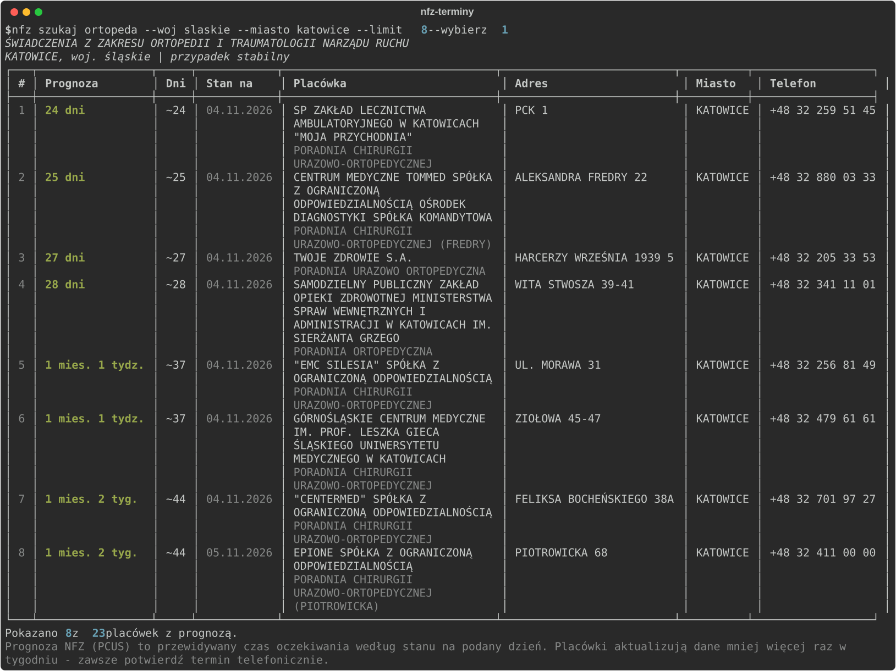

# nfz-terminy

[](https://github.com/Qubozaur/nfz-terminy/actions/workflows/ci.yml)


**Znajdź placówkę, w której najszybciej dostaniesz się do specjalisty na NFZ.**

`nfz-terminy` to darmowe narzędzie wiersza poleceń, które przeszukuje publiczne dane NFZ
„Terminy Leczenia” i pokazuje placówki posortowane od najkrótszego czasu oczekiwania:
z adresem i telefonem do rejestracji.

Dla kogo? Dla każdego, kto dostał skierowanie i nie chce czekać pół roku, bo nie wie,
że kilka kilometrów dalej kolejka jest kilka razy krótsza. Także dla osób, które pomagają
w tym rodzicom czy dziadkom.



> [!IMPORTANT]
> **Dane pochodzą z NFZ i nie są aktualizowane na bieżąco.** Placówki przekazują je mniej
> więcej raz w tygodniu, a NFZ publikuje **prognozę** czasu oczekiwania (PCUS), a nie
> konkretną wolną datę. **Zawsze potwierdź termin telefonicznie** w rejestracji.
> To nie jest oficjalna aplikacja NFZ.

## Instalacja

Potrzebny jest Python 3.11 lub nowszy. Jedna komenda:

```bash
pipx install git+https://github.com/Qubozaur/nfz-terminy
```

(albo `pip install git+https://github.com/Qubozaur/nfz-terminy`, jeśli nie używasz
[pipx](https://pipx.pypa.io/)). Po instalacji dostępna jest komenda `nfz`.

## Przykłady

```bash
# ortopeda w Katowicach - polskie znaki można pominąć
nfz szukaj ortopeda --woj slaskie --miasto katowice

# przypadek pilny (skierowanie z dopiskiem "pilne"), 10 najlepszych wyników
nfz szukaj okulista --woj mazowieckie --miasto warszawa --pilny --limit 10

# całe województwo, bez miasta
nfz szukaj "poradnia dermatologiczna" --woj łódzkie

# jakie dokładnie nazwy świadczeń zna NFZ?
nfz swiadczenia kardio

# kody województw
nfz wojewodztwa
```

Gdy nazwa pasuje do kilku świadczeń (np. „ortopeda” to poradnia, ale też oddział szpitalny),
program pokaże listę do wyboru. W skryptach można od razu wskazać pozycję: `--wybierz 1`.

### Opcje `nfz szukaj`

| Opcja | Opis |
|---|---|
| `--woj`, `-w` | województwo: `śląskie`, `slaskie`, `12`, skrót `maz` |
| `--miasto`, `-m` | miejscowość, z polskimi znakami lub bez (bez znaków wymaga `--woj`) |
| `--pilny` | przypadek pilny zamiast stabilnego |
| `--limit`, `-n` | ile placówek pokazać (domyślnie 20) |
| `--wybierz N` | wybierz N-te świadczenie z listy bez pytania |
| `--json` | wynik w formacie JSON |

### Wyjście JSON

```bash
nfz szukaj ortopeda --woj slaskie --miasto katowice --wybierz 1 --json --limit 1
```

```json
{
  "query": {
    "benefit": "ŚWIADCZENIA Z ZAKRESU ORTOPEDII I TRAUMATOLOGII NARZĄDU RUCHU",
    "province": "12",
    "province_name": "śląskie",
    "locality": "KATOWICE",
    "urgent": false
  },
  "source": "https://apinfz.nfz.gov.pl/app-itl-api-pcus",
  "total": 23,
  "without_forecast": 0,
  "results": [
    {
      "benefit": "ŚWIADCZENIA Z ZAKRESU ORTOPEDII I TRAUMATOLOGII NARZĄDU RUCHU",
      "pcus": "24 dni",
      "wait_days": 24,
      "situation_as_at": "2026-11-04",
      "provider": "SP ZAKŁAD LECZNICTWA AMBULATORYJNEGO W KATOWICACH \"MOJA PRZYCHODNIA\"",
      "place": "PORADNIA CHIRURGII URAZOWO-ORTOPEDYCZNEJ",
      "address": "PCK 1",
      "locality": "KATOWICE",
      "registration_phone": "+48 32 259 51 45",
      "elevator": true,
      "ramp": false,
      "...": "..."
    }
  ]
}
```

Pełna lista pól: [`QueueEntry` w `models.py`](src/nfz_terminy/models.py).

## Jak czytać wyniki

- **Prognoza**: tekst z NFZ, np. `24 dni` albo `1 mies. 2 tyg.`. To przewidywany czas
  do udzielenia świadczenia (PCUS) liczony przez NFZ, a nie zarezerwowana data.
- **Dni**: ta sama prognoza w przybliżeniu w dniach (miesiąc = 30 dni), według niej sortujemy.
- **Stan na**: dzień, na który NFZ wyliczył prognozę.
- Placówki, które nie podały prognozy, są pomijane. Ich liczba jest podana pod tabelą.

## Skąd są dane

Z publicznego API NFZ [„Terminy Leczenia”](https://apinfz.nfz.gov.pl/app-itl-api-pcus/)
w wersji 1.4. Kilka rzeczy, które warto wiedzieć, jeśli chcesz z niego korzystać sam:

- Starsza wersja 1.3 (`api.nfz.gov.pl/app-itl-api/`) jest wycofana i nie zwraca już terminów.
- Wersja 1.4 zamiast daty pierwszego wolnego terminu podaje prognozę `dates.pcus`.
- Wyszukiwanie rozróżnia polskie znaki („lodz” nie znajdzie „ŁÓDŹ”). `nfz-terminy` radzi
  sobie z tym, porównując nazwy z lokalnie zapamiętanym słownikiem miejscowości województwa.
- Nazwy świadczeń dopasowywane są jako fragment tekstu, więc „PORADNIA X” zwraca też
  „PORADNIA X DLA DZIECI”; narzędzie odfiltrowuje to, czego nie wybrano.
- API ogranicza liczbę zapytań (HTTP 429). Klient robi przerwy między zapytaniami
  i ponawia próby z rosnącym odstępem.

## Użycie jako biblioteki

Klient API jest oddzielony od CLI, więc można go użyć we własnym skrypcie, bocie czy stronie:

```python
from nfz_terminy.client import NfzClient
from nfz_terminy.search import find_queues, resolve_benefit

with NfzClient() as client:
    benefit = resolve_benefit(client, "okulista")[0]
    result = find_queues(client, benefit=benefit, province="07", locality="WARSZAWA")
    for entry in result.entries[:5]:
        print(entry.pcus, entry.provider, entry.address, entry.registration_phone)
```

## Rozwój

```bash
git clone https://github.com/Qubozaur/nfz-terminy
cd nfz-terminy
python -m venv .venv
source .venv/bin/activate          # Windows: .venv\Scripts\activate
pip install -e ".[dev]"

pytest                             # testy (API zamockowane, bez sieci)
ruff check . && ruff format --check .
mypy
```

Testy korzystają z prawdziwych odpowiedzi API zapisanych w [`tests/fixtures/`](tests/fixtures/).
Zrzut ekranu w README odświeża `python scripts/zrzut_ekranu.py`.

## Plany

- [x] Wyszukiwarka w terminalu
- [ ] `nfz obserwuj`: powiadomienie na Telegramie, gdy pojawi się krótsza kolejka
- [ ] Prosta strona WWW z mapą i filtrami dostępności (podjazd, winda, świadczenia dla dzieci)

Zgłoszenia błędów i pomysły mile widziane w [Issues](https://github.com/Qubozaur/nfz-terminy/issues).

## Licencja

[MIT](LICENSE). Dane: Narodowy Fundusz Zdrowia, API „Terminy Leczenia”
([regulamin](https://apinfz.nfz.gov.pl/app-itl-api-pcus/)).
